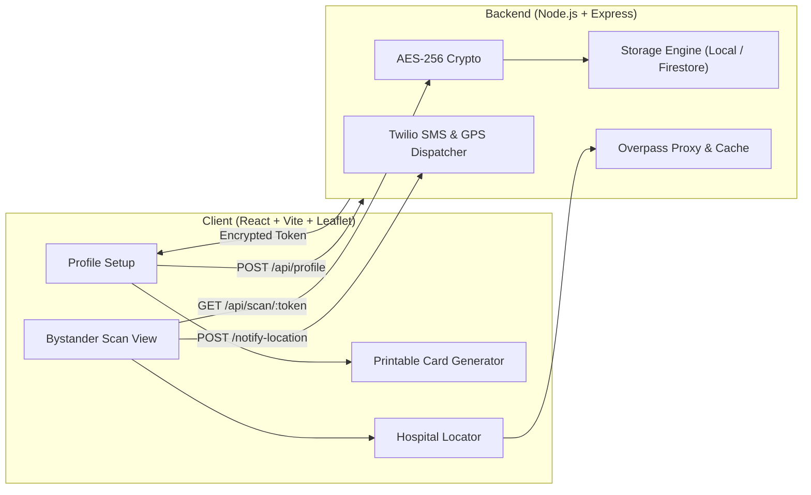

# 🚑 ResQQR — Emergency Response QR System

> A life-saving digital emergency medical ID platform designed for the **3-Second Bystander Triage Rule**. Scannable with any smartphone camera without app installation, featuring AES-256 encrypted tokens, automated GPS family beacons, Overpass hospital location routing, and printable wallet cards.

---

## ⚡ Key Highlights

1. **The 3-Second Rule Mobile Triage**: High-contrast emergency visual hierarchy displaying blood type, severe anaphylaxis/drug warnings, chronic illnesses, and medical notes immediately.
2. **Zero Plaintext IDs (AES-256-CBC)**: Database primary keys are never leaked in public URLs. The QR token is encrypted with AES-256 and unique IVs.
3. **Automated GPS Family Beacon**: Bystanders can transmit their live GPS coordinates directly to emergency contacts with one tap (via Twilio SMS or interactive simulator).
4. **Free Hospital & Trauma Locator**: Queries OpenStreetMap via Overpass API for emergency departments within radius, with direct Google Maps navigation.
5. **Interactive First Aid Guidance & CPR Metronome**: Integrated 105 BPM rhythmic CPR pulse, EpiPen administration guidelines, seizure safety, and recovery position instructions.
6. **Printable Wallet ID & Lockscreen Badge**: ISO ID-1 (85.6mm × 54mm) front and back credit card format ready for single-click printing and laminating.
7. **Dual Storage Engine**: Zero-configuration local persistent JSON store out of the box + optional plug-and-play Firebase Firestore.
8. **Multi-Language Translation & Speech**: Instant 5-language UI switching (English, Spanish, French, Mandarin, Hindi) and localized Web Speech synthesizer.
9. **Privacy PIN & Paramedic Override**: Gated sensitive conditions/medications behind a 4-digit PIN while keeping life-saving triage vitals immediately visible.
10. **Progressive Web App (PWA) Offline Resilience**: Service Worker asset caching and offline GPS beacon queuing that automatically syncs upon cellular reconnection.

---

## 🏗️ Architecture



---

## 🚀 Quick Start

### 1. Install Dependencies
```bash
npm run install:all
```

### 2. Run Backend & Frontend

In terminal 1 (Backend):
```bash
npm run backend
```
*Backend runs on `http://localhost:3000`.*

In terminal 2 (Frontend):
```bash
npm run frontend
```
*Frontend runs on `http://localhost:5173`.*

---

## 🧪 Testing & Verification

Run the automated backend sanity test:
```bash
npm test
```
This verifies:
- AES-256 encryption and decryption round-trip.
- Local persistent storage and profile lookup.
- Emergency GPS beacon notification formatting.
- Hospital locator fallback resiliency.

---

## 📱 Routes & Pages

| Route | Page / Function |
|---|---|
| `/` | Landing page with 3-second triage walkthrough and interactive demo simulator. |
| `/dashboard` | Medical profile creator, allergy tags, blood group selector, and live QR generator. |
| `/scan/:token` | High-urgency mobile responder view with one-tap contact dialer, GPS beacon, and hospital map. |
| `/card/:token` | Printable wallet card (front & back) with cut lines and lockscreen wallpaper guide. |

---

## 🔒 Security & Privacy

- **Safe Public Exposure**: Scans return only vital emergency triage data (Blood type, allergies, conditions, meds, primary contact).
- **Key Derivation**: 256-bit encryption key securely derived with SHA-256.
- **Configurable Twilio Alerts**: Real SMS dispatch when credentials exist in `.env`, or automatic developer simulator mode when absent.
